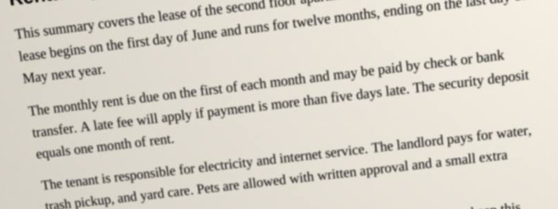
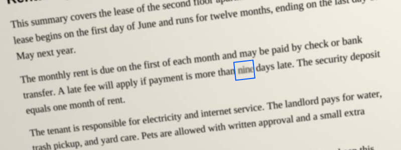
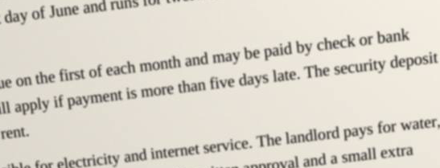
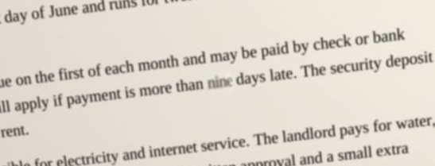
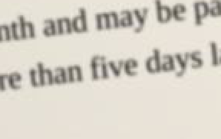
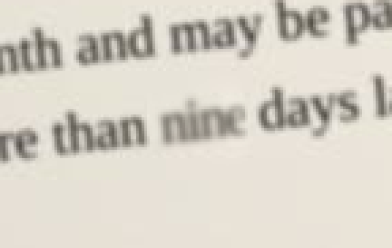

# FreeRangePDF: proof of method (stage 1, no app UI)

Last run: Sun Oct 18 2026 08:14:56 GMT-0700 (Pacific Daylight Time). Headless Chrome (Playwright) against a static page on `127.0.0.1`; every other host is aborted and logged. Blocked external requests: **0**. All libraries are vendored under `vendor/`.

**Stand-ins only.** Every input in this repo is a stand-in I made (`proof/inputs/`). The proof on the real scanned bill is kept outside the repo and is not quoted here. Its report is `REPORT-real.md` in that external folder, generated by the runner when `FRM_PDF_PRIVATE` points at that folder. `scripts/check-no-private.sh` (installed as the git pre-commit hook) refuses to commit any file from it.

## Summary

| check | result |
|---|---|
| routing | text PDFs → path A; scan, photo and searchable scan → path B (a full-page image with no visible text, even with an invisible OCR layer) |
| only the edited word changes; nothing to the right moves | yes, every case (text: 0 px changed outside the box; scans: 0 px outside the patch, checked by 2 decoders) |
| width rule | ±0.04 em spacing, then ×0.97–1.03, then natural width with the gap reported (the gap rectangle is in the preview data, `result.json → preview`), longer → refused, nothing written |
| old word gone (image OCR, hidden layer, raw bytes) | yes |
| EXIF/GPS/XMP/ICC/thumbnails gone (photo) | yes |
| lossless whole-image re-save; fresh save; no orphans | yes |
| hidden layer | editability comes from OUR OCR. Scanner runs that cover the word are replaced in place; if they don't (a scanner layer that lost the line), that line's scanner runs are removed and a fresh invisible line is written from our corrected OCR. Under-80 words on a rewritten line must be confirmed first (Save is blocked otherwise). |
| refusal | only when our own OCR can't read the line or the word ("NOT EDITABLE: our OCR could not read this line …") |
| OCR accuracy | PROVISIONAL (simulated stand-ins): scan 100.0%, photo 100.0% |

## Look fixes in this run (photo stand-in)

| measure | before this run | now | target |
|---|---|---|---|
| patch edge step on paper (mean abs, same spots before = 0.48) | 3.36 | **0.483** | ≤ 0.6, near 0.48 |
| stem width 50%, new / untouched px | 6.84 / 7.89 | **7.947 / 7.924** (0.3%) | within 2% (box metric; see below)  |
| stroke-core median (eroded ink mask), new / untouched | – | **139.8 / 120** | ±4 |
| ink median RGB, new / untouched | 160,157,150 / 149,144,135 | **160,154,145 / 149,144,135** | |
| edge 10–90% px, new / untouched (sharpest untouched 3.998) | 4.31 / 4.34 | **4.293 / 4.34** | not the sharpest |
| grain std inside patch / ring | 0.79 / 0.77 | **0.819 / 0.715** | |
| re-OCR of the edited line | (nine) | `transfer. A late fee will apply if payment is more than nine days late. The security deposit` | |

How:
- **Paper:** rebuilt only from plain paper. Ink is found against a per-pixel local paper level (grey closing), so the lighting gradient never counts as ink. Only ink blobs belonging to the old word are removed; neighbouring letters that poke into the box stay. Every letter pixel (dilated 3 px) is excluded from the inpaint source. Grain is resampled from paper at least 7 px from any letter.
- **Coloured marks** (handwriting, stamps; chroma > 40) are never part of a printed word. They are not removed and do not feed the inpaint, and they are excluded from the patch mask. The patch covers only pixels the edit actually changed, so everything else in the box stays bit-identical.
- **Seam:** Poisson clone: a Laplace membrane pinned to the original pixels along the box border, then a 3-px feather. The box is axis-aligned on the deskewed page, so in the stored image the blend follows the page tilt.
- **Weight and tone:** stroke weight is fitted first (continuous erode/dilate on the 8× supersampled sharp glyphs, before any blur). Then blur, then the ink tone through the colour, with a saturation gain allowed, then the weight again so the stem stays within 2%. Heavy erosion with saturation is penalised so letters stay whole.

300% crops (nearest neighbour): `proof/photo/vis300_before.png`, `proof/photo/vis300_after.png`; 100%: `proof/photo/vis100_before.png`, `proof/photo/vis100_after.png`.

## 2. Width rule (all text cases, re-run)
Rule: (1) letter spacing up to ±0.04 em per letter gap; (2) then horizontal scale 0.97–1.03 on top; (3) still shorter → natural width from the original start point, with the gap reported and shown in the preview; (4) still longer → refused, nothing written. Nothing to the right ever moves.

| case | edit | slot | natural | spacing | scale | gap | decision |
|---|---|---|---|---|---|---|---|
| main | `wet weather` → `winter freeze` | 58.26pt | 62.953pt | -0.0326 em | 1 | 0pt | fits: spacing -0.0326 em per letter, no scaling; following words do not move |
| midline-single-TJ-embedded | `eleven` → `twelve` | 31.284pt | 31.944pt | -0.011 em | 1 | 0pt | fits: spacing -0.0110 em per letter, no scaling; following words do not move |
| shorter-word-gap | `Thursday` → `Friday` | 45.276pt | 31.308pt | 0 em | 1 | 13.968pt | still shorter after max spacing and scale -> drawn at natural width from the original start; gap reported |
| overflow-refused | `spare parts` → `a spare nozzle` | 51.636pt | 67.957pt | tried -0.04 em | tried 0.97 | - | **REFUSED**, nothing written: replacement is 67.96pt; the slot is 51.64pt. Even at -0.040 em spacing and 97.0% scale it is 8.23pt too long, and the words to its right may not move. Nothing written. |
| separate-runs | `Monday` → `Tuesday` | 39.134pt | 42.19pt | -0.04 em | 0.9895 | 0pt | fits: spacing -0.0400 em per letter, scale 98.95%; following words do not move |
| repeated-block | `17` → `26` | 12.235pt | 12.235pt | 0 em | 1 | 0pt | fits: spacing 0.0000 em per letter, no scaling; following words do not move |
| scan stand-in | `yearly` → `annual` | 133px | 146.7px | -0.04 em | 0.9718 | 0px | fits: spacing -0.0400 em, scale 0.972 |
| photo stand-in | `five` → `nine` | 86px | 91.6px | -0.0331 em | 1 | 0px | fits: spacing -0.0331 em, scale 1.000 |
| searchable stand-in | `yearly` → `annual` | 133px | 146.7px | -0.04 em | 0.9718 | 0px | fits: spacing -0.0400 em, scale 0.972 |
| searchable, rewritten line | `morning.` → `evening.` | 190px | 184.2px | 0.0175 em | 1 | 0px | fits: spacing 0.0175 em, scale 1.000 |

`wet weather` → `winter freeze` (natural 92.6% too wide) now **fits** at −0.0326 em per letter over 13 letters (≤ 0.04 em), so it didn't need rewording. The refused case is `spare parts` → `a spare nozzle`, which is still 8.23pt too long at −0.04 em and ×0.97.

## 3. Text PDFs: path A
- **main** (`proof/text/`): `the new coop doors have held up well through the wet weather.` → pdf.js reads `the new coop doors have held up well through the winter freeze.` (match yes). Font fallback (Liberation Serif Regular 2.1.5; subset lacks ["z"]; whole run switched, span chars 49–62, bbox {"x0":314.584,"y0":558.61,"x1":372.844,"y1":574.45}). Pixels changed outside the edited box: **0**; right of the box on the same line: **0/17136**; untouched glyph max shift 1.137e-13pt.
- **midline-single-TJ-embedded** (`proof/text/midline-single-tj/`): `Our egg sales rose by eleven percent compared with last year. Most of the growth came from the ` → pdf.js reads `Our egg sales rose by twelve percent compared with last year. Most of the growth came from the` (match yes). Font embedded. Pixels changed outside the edited box: **0**; right of the box on the same line: **0/29674**; untouched glyph max shift 0pt.
- **shorter-word-gap** (`proof/text/shorter-word/`): `Thursday morning with tools and spare parts. Please bring gloves and a flask of tea, because the ` → pdf.js reads `Friday morning with tools and spare parts. Please bring gloves and a flask of tea, because the` (match yes). Font embedded. Pixels changed outside the edited box: **0**; right of the box on the same line: **0/36519**; untouched glyph max shift 0pt.
- **overflow-refused**: `spare parts` → `a spare nozzle` REFUSED by the width rule. replacement is 67.96pt; the slot is 51.64pt. Even at -0.040 em spacing and 97.0% scale it is 8.23pt too long, and the words to its right may not move. Nothing written. Input unchanged.
- **separate-runs** (`proof/text/separate-runs/`): `Keys will be handed over at the front office on Monday after ten.` → pdf.js reads `Keys will be handed over at the front office on Tuesday after ten.` (match yes). Font embedded. Pixels changed outside the edited box: **0**; right of the box on the same line: **0/18632**; untouched glyph max shift 0pt.
- **repeated-block** (`proof/text/repeated-block/`): `Name: Jordan Ellis    Unit: 2B    Parking space: 17    Deposit paid: yes` → pdf.js reads `Name: Jordan Ellis Unit: 2B Parking space: 26 Deposit paid: yes` (match yes). Font fallback (Liberation Sans Regular 2.1.5; subset lacks ["6"]; whole run switched, span chars 49–51, bbox {"x0":305.425,"y0":538.48,"x1":317.66,"y1":553}). Pixels changed outside the edited box: **0**; right of the box on the same line: **0/19924**; untouched glyph max shift 2.75e-8pt.

**Text-layer truth (pdf.js and pdftotext 25.03):** in every edited copy the new word reads correctly in both extractors, with 0 U+FFFD characters. This includes the fallback-font span: pdf-lib's subset carries a ToUnicode CMap, and my verifier decodes the `winter freeze` and `26` runs through it. Old-word hits: see §6. The only remaining `17` is the untouched Tenant copy (expected). `winter` shows 2 hits because "winter" already appears once elsewhere on the page.

## 4. Scan and photo stand-ins, searchable stand-in, rewritten hidden line

| stand-in | input | output | OCR accuracy (**PROVISIONAL**, simulated) |
|---|---|---|---|
| clean scan | `proof/inputs/scan-standin.pdf` | `proof/scan/scan-standin.edited.pdf` | 100.0% exact tokens; words < 80: none |
| crooked phone photo | `proof/inputs/photo-standin.pdf` (fake EXIF+GPS+EXIF thumbnail, ICC, XMP with GPS, /Thumb) | `proof/photo/photo-standin.edited.pdf` | 100.0%; words < 80: `42` (72) |

- Scan: `yearly` → `annual`; re-OCR `seed library, and a vote on the proposed change to the annual dues. Copies of the`. Photo: `five` → `nine`; re-OCR `transfer. A late fee will apply if payment is more than nine days late. The security deposit`.
- Searchable: the hidden run `yearly` was rewritten to `annual` in place ([{"before":"yearly","after":"annual","userX":370.74,"userY":591.99}]). pdftotext: `yearly` 0, `annual` 1. The first-line "annual" was hidden-layer text already. Per-show decode finds `annual` twice: one existing, one edited.
- **Scanner layer lost the line (searchable stand-in):** on the "Saturday…" line the stand-in's hidden layer kept only its first word. `morning` → `evening` is now **edited**, because our OCR read the line. The hidden layer was handled as follows: rewrote this line from our OCR (scanner runs did not cover the word). Scanner runs removed from the line box: ["Saturday,"]. New hidden line: `Saturday, May 16, starting at ten in the evening. All members are welcome, and guests`. Every other scanner run is unchanged: true (142 runs). Words under 80 on the line: 0. pdftotext: `morning` 0, `evening` 2. Output: `proof/searchable/out-rewrite/`.
- Stand-ins with no text layer (scan, photo) get a new invisible layer from our OCR, in Liberation Sans subset with ToUnicode, carrying the corrected line.
- Photo stroke weight is fitted **before** the blur: erode/dilate on the sharp 8× supersampled glyph mask, then Gaussian blur, then colour. The weight target is the 50%-level stem width (2 × area / boundary), which a blur barely moves.

| | before | after |
|---|---|---|
| line, 100% |  |  |
| word, 100% |  |  |
| word, 300% (nearest neighbour) |  |  |

Full page: [before](scan/before_full.png) · [after](scan/after_full.png) · [pdf.js diff](scan/diff_full.png) · [poppler diff](scan/diff_full_poppler.png) (red = changed inside the patch, blue = changed outside) · [patch](scan/patch.png) · [patch mask](scan/patch_mask.png) · [deskewed page](scan/corrected_page.png)

| | before | after |
|---|---|---|
| line, 100% |  |  |
| word, 100% |  |  |
| word, 300% (nearest neighbour) |  |  |

Full page: [before](photo/before_full.png) · [after](photo/after_full.png) · [pdf.js diff](photo/diff_full.png) · [poppler diff](photo/diff_full_poppler.png) (red = changed inside the patch, blue = changed outside) · [patch](photo/patch.png) · [patch mask](photo/patch_mask.png) · [deskewed page](photo/corrected_page.png)

## 5. Oholiab's visual set
All numbers come from the deskewed page, using the same code for every word, at a threshold halfway between paper and ink core. Deltas are new word minus the median of the untouched words in the same segment; the old word's own delta is given for reference. Crops at 100% and 300% are in each case's section above (`vis100_*`, `vis300_*`).

| case | baseline Δ px | x-height Δ px | cap Δ px | stem width new / untouched px | advance per char new / untouched px | gap before / after (px) | patch edge step (paper, mean abs) | grain std inside / ring |
|---|---|---|---|---|---|---|---|---|
| scan | 0 (old word 1) | -1 (old 0) | -10 | 4.322 / 4.323 (old 4.283) | 22.17 / 23.4 (old 22.17) | 17 (was 17) / 17 (was 17); typical 19 | 1.138 (before 1.138) | 2.011 / ring 1.638 (before 2.17) |
| photo | 0 (old word -1) | -3 (old -2) | -13 | 7.947 / 7.891 (old 7.144) | 18 / 20.57 (old 20) | 30 (was 29) / 24 (was 17); typical 26 | 0.483 (before 0.48) | 0.819 / ring 0.715 (before 1.014) |
| searchable | 0 (old word 1) | -1 (old 0) | -10 | 4.322 / 4.323 (old 4.283) | 22.17 / 23.4 (old 22.17) | 17 (was 17) / 17 (was 17); typical 19 | 1.138 (before 1.138) | 2.011 / ring 1.638 (before 2.17) |
| searchable rewrite | 1 (old word 0) | -2 (old -1) | -8 | 4.317 / 4.318 (old 4.173) | 23.75 / 23 (old 23.63) | 19 (was 19) / 18 (was 19); typical 19 | 1.175 (before 1.175) | 1.813 / ring 1.913 (before 2.146) |

Ink, edge and noise (target = untouched words on the segment → new word):

| case | ink median RGB | edge 10–90% px | noise std | stem width 50% px | drawn with | new word sharpest? |
|---|---|---|---|---|---|---|
| scan | 24,23,24 → **24,23,24** | 2.20 → **2.335** (sharpest untouched 2.081) | 4.48 → **3.42** | 4.323 → **4.322** | σ 1.05, weight -0.38px, rgb(6,5,6), colour target: ink median (p10 clipped to black) | no |
| photo | 149,144,135 → **160,154,145** | 4.34 → **4.293** (sharpest untouched 3.998) | 1.36 → **0.827** | 7.924 → **7.947** | σ 3.8296999999999985, weight 0.23px, rgb(107,102,93), colour target: ink p10 | no |

Reading the numbers:
- Photo seam: fixed (edge step 0.483 vs 0.48 untouched). Photo stem: **calibrated on the box metric to 7.947 vs 7.924**, but the word-only metric reads 7.947 vs 7.891 (0.7%), outside the 2% target, and the new word's edge (4.293) is sharper than the sharpest untouched word (3.998): **two photo targets missed**.
- Private real-document proofs (a scanned bill, two phone photos of a book back) are kept outside the repo under `$FRM_PDF_PRIVATE`; their reports are not part of this repo.

## 6. Old word is gone from the file

**Scans and photo: the edit is written into the page image.** The original JPEG is decoded in the browser (ICC applied, so colour stays correct), the patch is written into the pixels, and the whole image is re-saved losslessly as one FlateDecode stream with PNG predictors (DeviceRGB). The old JPEG stream is dropped, unreferenced objects are garbage-collected, and the file is a fresh full save.

| file | our decode of the saved stream vs composite | changed outside patch (browser decode) | **independent: poppler decode of input vs output, outside patch** | poppler render diff | patch px |
|---|---|---|---|---|---|
| scan | 0 | **0** | **0** (max Δ 0) | **0** beyond 2 px (48 in the 0–2 px ring) | 6917 |
| photo | 0 | **0** | **0** (max Δ 0) | **0** beyond 2 px (8 in the 0–2 px ring) | 1051 |
| searchable | 0 | **0** | **0** (max Δ 0) | **0** beyond 2 px (48 in the 0–2 px ring) | 6917 |
| searchable rewrite | 0 | **0** | **0** (max Δ 0) | **0** beyond 2 px (55 in the 0–2 px ring) | 8962 |

**Old/new word search** (`proof/tools/verify_file.py`, pikepdf/qpdf): every stream is decompressed and searched as plain text, as hex glyph codes, and by decoding every text-show operator through its font's ToUnicode or encoding. Every image is extracted with `pdfimages -png` and OCR'd with the path-B pipeline:

| file | pdftotext old-word hits in → **out** | old word in decoded text-show ops | plain-text hits (non-image streams) | glyph-code hits | OCR of every extracted image, old word in → **out** | incremental? / %%EOF / orphans | EXIF/GPS/XMP/Thumb/ICC/Metadata markers out (in) |
|---|---|---|---|---|---|---|---|
| searchable (yearly→annual) | 1 → **0** (1 × `annual`) | 0 (expected 0) | 0 | 0 | 1 → **0** | no / 1 / 0 | 0 (input 0) |
| searchable rewrite (morning→evening) | 0 → **0** (2 × `evening`) | 0 (expected 0) | 0 | 0 | 1 → **0** | no / 1 / 0 | 0 (input 0) |
| scan (yearly→annual) | 0 → **0** (2 × `annual`) | 0 (expected 0) | 0 | 0 | 1 → **0** | no / 1 / 0 | 0 (input 0) |
| photo (five→nine) | 0 → **0** (1 × `nine`) | 0 (expected 0) | 0 | 0 | 1 → **0** | no / 1 / 0 | 0 (input 15) |
| main (wet weather→winter freeze) | 1 → **0** (1 × `winter freeze`) | 0 (expected 0) | 0 | 0 | no images → **n/a** | no / 1 / 0 | 4 (input 4) |
| midline-single-TJ-embedded (eleven→twelve) | 1 → **0** (1 × `twelve`) | 0 (expected 0) | 0 | 0 | no images → **n/a** | no / 1 / 0 | 4 (input 4) |
| shorter-word-gap (Thursday→Friday) | 1 → **0** (1 × `Friday`) | 0 (expected 0) | 0 | 0 | no images → **n/a** | no / 1 / 0 | 4 (input 4) |
| separate-runs (Monday→Tuesday) | 1 → **0** (1 × `Tuesday`) | 0 (expected 0) | 0 | 0 | no images → **n/a** | no / 1 / 0 | 0 (input 0) |
| repeated-block (17→26) | 2 → **1** (1 × `26`) | 1 (expected 1) | 0 | 1 | no images → **n/a** | no / 1 / 0 | 0 (input 0) |

- repeated-block: the single remaining `17` is the untouched Tenant copy, as expected. The `26` plain hits are inside the binary font program (byte pattern), not text.
- Photo: the input carried EXIF (Make/Model/DateTime), a GPS IFD, an EXIF thumbnail, an ICC profile, XMP with GPS in the catalog and on the image, and a /Thumb page thumbnail. **All gone** in the output: catalog /Metadata (XMP); page 1 /Thumb; page image /Metadata (XMP) - dropped with the old image; JPEG APP1 EXIF (incl. GPS IFD and IFD1 thumbnail) - dropped with the old JPEG stream; JPEG APP2 ICC profile - applied while decoding, then dropped (pixels are sRGB, written as DeviceRGB).
- The text PDFs (LibreOffice inputs) count 4 markers in both input and output: their document-level XMP packet (`/Metadata` + `xmpmeta`, 2 each). It holds producer/date only, no GPS and no edited word (the word search covers that stream too). It's kept because those are text documents, not photos.
- The text PDFs are a fresh full save (no incremental section, 1 %%EOF), unreachable objects removed (including old content streams and LibreOffice's indirect /Length objects), and 0 orphans in the raw object graph.

**File-size cost**

| file | input | output | factor | image stream |
|---|---|---|---|---|
| scan | 1122 KB | 7320 KB | ×6.52 | 1120 KB JPEG → 7304 KB Flate+PNG predictor |
| photo | 153 KB | 831 KB | ×5.42 | 148 KB JPEG → 815 KB Flate+PNG predictor |
| searchable | 1126 KB | 7309 KB | ×6.49 | 1120 KB JPEG → 7304 KB Flate+PNG predictor |

| text case | input | output | factor | note |
|---|---|---|---|---|
| main | 20 KB | 25 KB | ×1.27 | adds a subset fallback font |
| midline-single-TJ-embedded | 20 KB | 20 KB | ×1.01 | no new font |
| shorter-word-gap | 20 KB | 20 KB | ×1.01 | no new font |
| overflow-refused | 20 KB | (refused, no file) | | |
| separate-runs | 15 KB | 15 KB | ×1.00 | no new font |
| repeated-block | 15 KB | 19 KB | ×1.27 | adds a subset fallback font |

## Inputs unchanged (SHA-256 before and after)

| file | before | after | |
|---|---|---|---|
| text-standin.pdf | `b7e45aa7b7806c9dad3b80daaa4394b306d6ba332ffad1b7cbe0770f3e1c159b` | `b7e45aa7b7806c9dad3b80daaa4394b306d6ba332ffad1b7cbe0770f3e1c159b` | unchanged |
| text-runs-standin.pdf | `a092f47dba142f21ece7e43bf39576077fdc79cd060dfefb1798dbd61d3b1c4b` | `a092f47dba142f21ece7e43bf39576077fdc79cd060dfefb1798dbd61d3b1c4b` | unchanged |
| scan-standin.pdf | `7fe78d6ac0dd9719453f3e44b0e8bd4ee55d784027f19a2b356269ecadde9af1` | `7fe78d6ac0dd9719453f3e44b0e8bd4ee55d784027f19a2b356269ecadde9af1` | unchanged |
| photo-standin.pdf | `1acb6370268c73b1c8efb177ea111ad2fd28bcdeb218947f24ed0f1611b3bb50` | `1acb6370268c73b1c8efb177ea111ad2fd28bcdeb218947f24ed0f1611b3bb50` | unchanged |
| searchable-standin.pdf | `aa46a16a621604d8f0dbcbd7f10f5f881d1ccd7ac4df89a582f4fc0d2e28e59f` | `aa46a16a621604d8f0dbcbd7f10f5f881d1ccd7ac4df89a582f4fc0d2e28e59f` | unchanged |

mtimes unchanged: true.

## Fonts (all SIL OFL 1.1)

| font | file | licence file |
|---|---|---|
| Liberation Serif Regular 2.1.5 | `vendor/fonts/liberation/LiberationSerif-Regular.ttf` | `vendor/fonts/liberation/LICENSE` (OFL 1.1, upstream tag 2.1.5); Debian copyright: `vendor/fonts/liberation/debian-copyright.txt` |
| Liberation Sans Regular 2.1.5 | `vendor/fonts/liberation/LiberationSans-Regular.ttf` | same |
| Liberation Mono Regular 2.1.5 | `vendor/fonts/liberation/LiberationMono-Regular.ttf` | same |

The fonts' own name tables say "Licensed under the SIL Open Font License, Version 1.1". They are metric-compatible with Times New Roman, Arial and Courier New. Only Regular weights are bundled for now. Bold and italic lines would need the Bold, Italic and BoldItalic files (same family, same licence).
Note for Berean: `vendor/pdfjs/standard_fonts/` is pdf.js's own on-screen substitute set for non-embedded standard-14 fonts. It includes Foxit fonts (`LICENSE_FOXIT`, BSD-style, not OFL) and Liberation (`LICENSE_LIBERATION`). Those files are only used to *display* PDFs and are never embedded in an output file. If OFL-only applies to every font file shipped, drop the Foxit files and let pdf.js fall back.

## Vendored libraries (no CDN at runtime)

| library | version | licence | licence / notice files |
|---|---|---|---|
| pdf.js (pdfjs-dist) | 5.4.296 | Apache-2.0 | `vendor/pdfjs/LICENSE`, `vendor/pdfjs/NOTICE` |
| pdf-lib | 1.17.1 | MIT | `vendor/pdf-lib/LICENSE.md`, `vendor/pdf-lib/NOTICE` |
| @pdf-lib/fontkit | 1.1.1 | MIT | `vendor/fontkit/LICENSE` (the package ships no licence file; I wrote it from package.json "MIT" plus the upstream holder) |
| Tesseract.js | 7.0.0 | Apache-2.0 | `vendor/tesseract/LICENSE.md`, `vendor/tesseract/NOTICE`, bundled third-party notices `vendor/tesseract/*.LICENSE.txt` |
| tesseract.js-core (WASM Tesseract + Leptonica) | 7.0.0 | Apache-2.0 (Leptonica BSD-2-style) | `vendor/tesseract/core/LICENSE` |
| tessdata_fast eng.traineddata | main branch (sha256 in `vendor/SHA256SUMS`) | Apache-2.0 | `vendor/tessdata/LICENSE`, `vendor/tessdata/NOTICE` |
| OpenCV.js | **4.9.0** (official prebuilt, docs.opencv.org/4.9.0/opencv.js) | **Apache-2.0** (OpenCV ≥ 4.5) | `vendor/opencv/LICENSE`, `vendor/opencv/COPYRIGHT`, `vendor/opencv/NOTICE` |

Upstream Tesseract.js, tesseract and tessdata_fast ship no NOTICE file, so I wrote the NOTICE files above for Apache-2.0 §4(d) attribution. `vendor/SHA256SUMS` lists every vendored file. `scripts/vendor.sh` rebuilds `vendor/`.

## Limits and open items
- All photo numbers are on a simulated photo.
- Stand-in OCR figures are PROVISIONAL (simulated, clean synthetic text).
- pdf-lib names the fallback font without a subset tag (`LiberationSerif-xxxx`), though fontkit does subset it.
